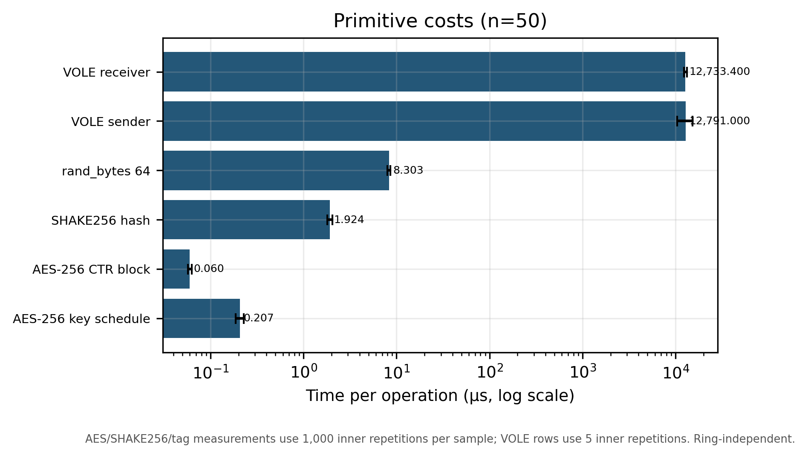
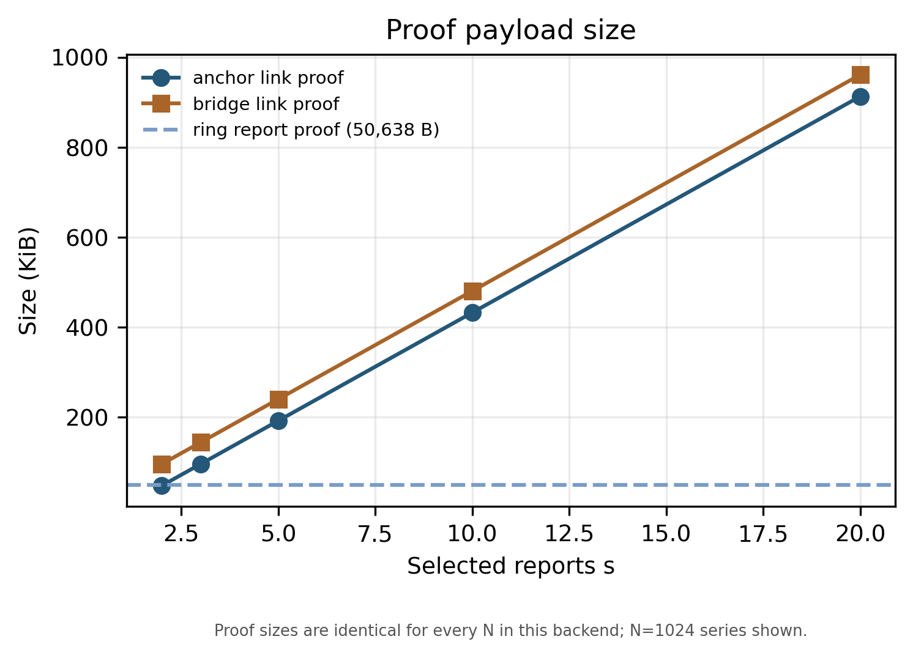
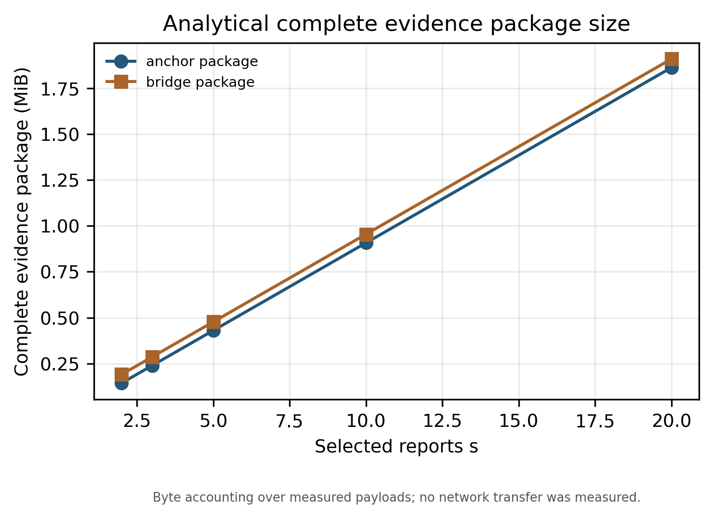
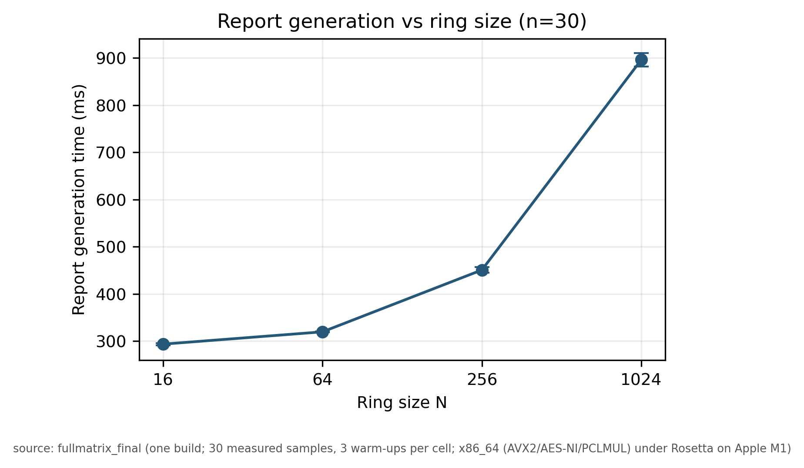
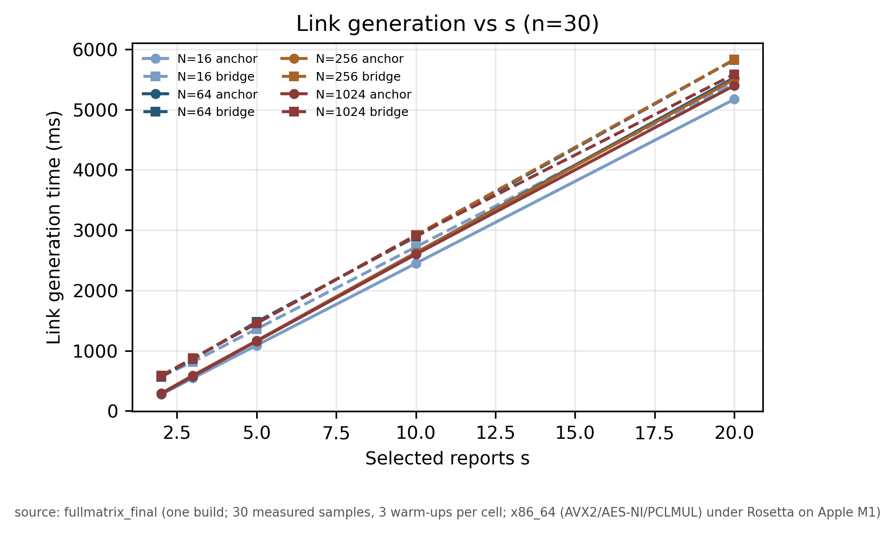
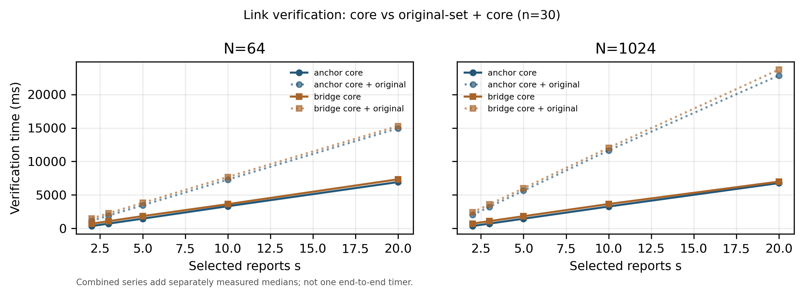
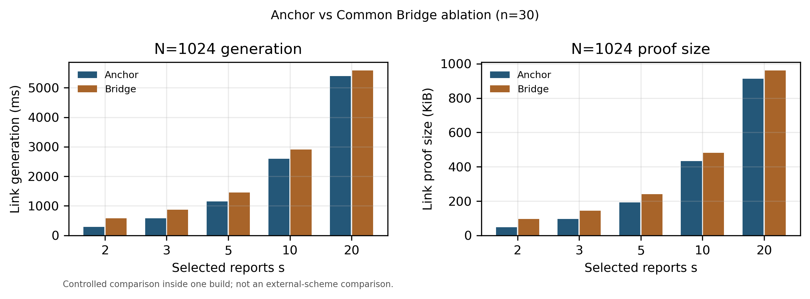
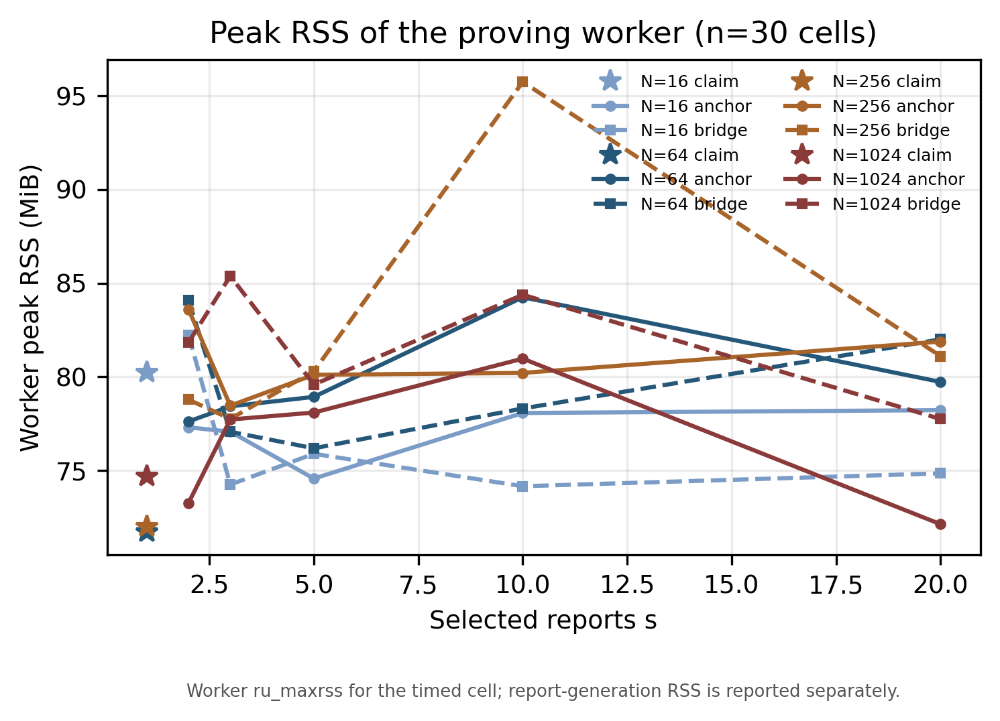

# VII. 性能评估与比较（PERFORMANCE EVALUATION AND COMPARISON）

本节从基础运算、计算开销、通信开销、扩展性以及安全属性等方面，对 CLARIS 进行实验评估，并与已有环签名、可认领环签名和可链接环签名方案进行比较。实验重点考察两个参数：环成员数量 \(N\) 和参与关联的报告数量 \(s\)。其中，\(N\) 用于衡量匿名环规模，\(s\) 用于衡量一次选择性关联所涉及的报告数量。

与仅测试单个参数组合不同，本文在统一构建和实验环境下完成了完整测试矩阵。环规模取值为 \(N\in\{16,64,256,1024\}\)，关联报告数量取值为 \(s\in\{2,3,5,10,20\}\)，并以 \(s=1\) 作为 Claim 基准。对于每个参数组合，分别测试 Anchor 和 Common Bridge 两种关联结构。每组实验预热 3 次，正式测量 30 次，并保留全部原始样本。

本节首先介绍实验环境和基础密码运算的测试结果，然后分析报告生成、报告验证、身份认领和选择性关联的计算开销；随后比较不同结构的通信开销与内存占用，并讨论参数变化对性能的影响。最后，结合已有方案的构造特点和安全属性，分析 CLARIS 的功能定位及其性能代价。

## A. 实验环境与基础运算（Experimental Environment and Primitive Operations）

### 1）实验环境

实验在 Apple M1 笔记本电脑上完成，硬件具有 8 个物理核心、8 个逻辑核心和 8 GiB 内存，操作系统为 macOS 15.3（Build 24D60）。代码使用 Apple Clang 16.0.0 编译。为启用 AVX2、AES-NI 和 PCLMUL 优化，实验构建为 x86-64 目标程序，并通过 Rosetta 2 在 Apple M1 上执行。因此，本文所报告的运行时间包含指令翻译开销，不能直接视为原生 x86-64 或原生 ARM 环境下的性能。

实验采用的转录配置为 CLARIS-Q-v2-G-v1。所有环规模使用同一构建产物，构建清单的 SHA-256 值为：

\[
\texttt{534301c2171bfbbea5fe3f62da6a95e5661b6064522894427cebc1a32193119e}.
\]

实验的主要配置如表 I 所示。

**表 I 实验环境**

| 项目 | 配置 |
|---|---|
| 处理器 | Apple M1，8 核 |
| 内存 | 8 GiB |
| 操作系统 | macOS 15.3（24D60） |
| 编译器 | Apple Clang 16.0.0 |
| 编译目标 | x86-64 |
| 指令集优化 | AVX2、AES-NI、PCLMUL |
| 优化选项 | \(-O2\)，关闭断言 |
| 执行方式 | Rosetta 2 翻译执行 |
| 转录配置 | CLARIS-Q-v2-G-v1 |
| 预热次数 | 每组 3 次 |
| 正式测量次数 | 每组 30 次 |

### 2）基础密码运算测试

为分析 CLARIS 各阶段的计算开销，首先对代码实际使用的基础运算进行独立测试。根据实现，选取 AES-256 密钥扩展、AES-256 CTR 分组运算、SHAKE256 哈希、随机数生成以及 VOLE 发送端和接收端运算，共六项操作。每项操作进行 50 次测量；对于 AES、SHAKE256 和随机数生成等较短操作，内层重复 1000 次后计算单次平均耗时；VOLE 操作的内层重复次数为 5 次。

表 II 给出了各项运算的中位数、平均值、标准差和 P95。为便于比较，时间统一换算为微秒（\(\mu s\)）。

**表 II 基础密码运算时间**

| 基础运算 | 中位数（\(\mu s\)） | 平均值（\(\mu s\)） | 标准差（\(\mu s\)） | P95（\(\mu s\)） |
|---|---:|---:|---:|---:|
| AES-256 密钥扩展 | 0.2070 | 0.2137 | 0.0208 | 0.2358 |
| AES-256 CTR 分组运算 | 0.0600 | 0.0597 | 0.0027 | 0.0610 |
| SHAKE256 哈希 | 1.9245 | 1.9813 | 0.1162 | 2.2293 |
| 生成 64 字节随机数 | 8.3030 | 8.4053 | 0.3249 | 9.2304 |
| VOLE 发送端 | 12,791.0000 | 13,314.5880 | 2,385.8586 | 14,967.5300 |
| VOLE 接收端 | 12,733.4000 | 12,816.1160 | 469.8041 | 13,830.0200 |

<text-placeholder />

从表 II 可以看出，VOLE 发送端和接收端操作的单次耗时明显高于 AES、SHAKE256 和随机数生成操作。结合后续的调用次数统计可以发现，普通证明生成和验证过程中均会调用 VOLE 子程序，因此 VOLE 运算是影响证明计算时间的重要组成部分。AES 和 SHAKE256 虽然单次执行时间较短，但在证明构造过程中调用次数较多，同样构成整体计算开销的一部分。

图 1 展示了六项基础运算的运行时间。由于不同运算的时间尺度差异较大，图中按照原始测量值进行展示。

## B. 通信开销分析（Communication Overhead Analysis）

通信开销主要包括原始匿名报告、Claim 证明、Link 证明以及多报告关联时形成的完整证据包。本文分别统计证明本体、证书封装和完整证据包的字节数，避免将证明大小与实际传输对象混为一谈。

### 1）原始匿名报告大小

表 III 给出了不同环规模下原始报告证明及报告载荷的大小。随着环成员数量 \(N\) 从 16 增加至 1024，原始报告证明大小由 50,638 B 增加至 50,792 B，仅增加 154 B；报告载荷大小由 50,830 B 增加至 50,984 B。与此同时，环成员注册表大小随环规模线性增加，从 2,048 B 增加至 131,072 B。

**表 III 不同环规模下原始报告的通信开销**

| 环规模 \(N\) | 报告证明大小（B） | 报告载荷大小（B） | 注册表大小（B） |
|---:|---:|---:|---:|
| 16 | 50,638 | 50,830 | 2,048 |
| 64 | 50,660 | 50,852 | 8,192 |
| 256 | 50,704 | 50,896 | 32,768 |
| 1024 | 50,792 | 50,984 | 131,072 |

实验结果表明，原始报告证明本身对环规模的变化不敏感，而注册表大小与环成员数量呈线性关系。因此，在分析完整证据传输开销时，需要同时考虑报告证明和相应的注册表数据。

### 2）Claim 与 Link 证明大小

在当前实现中，一个普通 Claim 证明或一条 Link edge 证明的大小均为：

\[
p_G=49,208\ \mathrm{B}.
\]

Claim 证书还包含认领者索引、报告标识和上下文等封装信息，其总大小为 49,276 B。对于选择性关联，Anchor 和 Common Bridge 使用的普通证明数量不同。Anchor 以一份报告作为锚点，为其余报告分别生成关联证明，因此需要 \(s-1\) 个普通证明；Common Bridge 为所选的 \(s\) 份报告分别生成证明，因此需要 \(s\) 个普通证明。

两种结构的核心证明大小分别为：

\[
C_{\mathrm{Anchor}}(s)=(s-1)p_G,
\]

\[
C_{\mathrm{Bridge}}(s)=sp_G.
\]

因此，Anchor 相比 Common Bridge 始终少一个普通证明，其核心证明大小固定减少：

\[
\Delta C=p_G=49,208\ \mathrm{B}.
\]

需要说明的是，Common Bridge 的完整关联证明还包含 64 B 的公开 Bridge tuple。因此，在统计包含该 tuple 的关联证明对象时，Bridge 的大小还需额外增加 64 B。

**表 IV 不同关联报告数量下的核心证明大小**

| 报告数量 \(s\) | Anchor 证明数 | Anchor 大小（B） | Bridge 证明数 | Bridge 大小（B，不含 tuple） |
|---:|---:|---:|---:|---:|
| 2 | 1 | 49,208 | 2 | 98,416 |
| 3 | 2 | 98,416 | 3 | 147,624 |
| 5 | 4 | 196,832 | 5 | 246,040 |
| 10 | 9 | 442,872 | 10 | 492,080 |
| 20 | 19 | 934,952 | 20 | 984,160 |

### 3）完整证据包大小

仅比较证明本体还不足以反映选择性关联的完整通信开销。为此，本文进一步统计了证书封装、报告载荷和 manifest 摘要组成的完整证据包。表 V 选取 \(s=20\) 作为示例，比较不同环规模下 Anchor 和 Common Bridge 的完整证据包大小。

**表 V \(s=20\) 时的完整证据包大小**

| 环规模 \(N\) | Anchor（B） | Common Bridge（B） |
|---:|---:|---:|
| 16 | 1,952,260 | 2,001,532 |
| 64 | 1,952,700 | 2,001,972 |
| 256 | 1,953,580 | 2,002,852 |
| 1024 | 1,955,340 | 2,004,612 |

从表 V 可以看出，随着环规模增大，完整证据包大小有所增加，主要原因是其中包含的原始报告载荷随环规模变化。对于相同的 \(N\) 和 \(s\)，Anchor 的完整证据包始终小于 Common Bridge。以 \(N=1024\)、\(s=20\) 为例，Anchor 的完整证据包为 1,955,340 B，Common Bridge 为 2,004,612 B，两者相差 49,272 B，其中 49,208 B 来自少生成的一份普通证明，另有 64 B 来自 Bridge tuple。

上述通信开销是依据实际生成的证明文件、报告载荷和协议封装字段进行的字节核算，并非在真实网络环境中测得的传输流量。因此，本文将其作为协议对象大小进行比较，不将其表述为网络传输时延或带宽测试结果。

图 2 展示了证明大小随关联报告数量变化的情况，图 3 展示了完整证据包大小随 \(s\) 变化的情况。

## C. 计算开销分析（Computational Overhead Analysis）

计算开销是本节的重点。本文分别测试原始报告生成与验证、身份认领证明生成与验证，以及选择性关联证明生成与验证。对于关联验证，还单独记录原始报告集合验证时间，以区分关联证明自身的验证开销与验证所选报告所需的开销。

### 1）原始报告生成与验证

表 VI 给出了不同环规模下原始报告的生成和验证时间。每组实验均进行 30 次正式测量，表中报告中位数和标准差。

**表 VI 原始匿名报告生成与验证时间**

| 环规模 \(N\) | 生成时间（ms） | 生成标准差（ms） | 验证时间（ms） | 验证标准差（ms） |
|---:|---:|---:|---:|---:|
| 16 | 293.80 | 6.34 | 358.02 | 4.64 |
| 64 | 319.87 | 1.58 | 380.40 | 9.20 |
| 256 | 450.91 | 11.70 | 486.79 | 33.72 |
| 1024 | 896.12 | 19.92 | 834.28 | 23.64 |

从表 VI 可以看出，原始报告生成时间随环规模增加而上升。当环规模由 16 增加至 1024 时，生成时间由 293.80 ms 增加至 896.12 ms；验证时间由 358.02 ms 增加至 834.28 ms。这说明环规模是影响原始匿名报告生成和验证效率的重要参数。

图 4 和图 5 分别展示了原始报告生成时间和验证时间随环规模变化的趋势。

### 2）身份认领证明的计算开销

身份认领阶段以 \(s=1\) 作为基准。表 VII 给出了不同环规模下 Claim 证明的生成、验证时间及原始报告验证时间。

**表 VII Claim 证明生成与验证时间**

| 环规模 \(N\) | Claim 生成（ms） | Claim 验证（ms） | 原始报告验证（ms） | 合并参考值（ms） |
|---:|---:|---:|---:|---:|
| 16 | 283.51 | 356.98 | 364.75 | 721.73 |
| 64 | 278.57 | 351.58 | 380.07 | 731.65 |
| 256 | 292.40 | 366.91 | 489.50 | 856.41 |
| 1024 | 286.72 | 363.63 | 839.91 | 1,203.53 |

从表 VII 可以看出，Claim 证明生成时间在不同环规模下保持在约 278.57–292.40 ms，验证时间保持在约 351.58–366.91 ms，变化幅度较小。与原始报告生成和验证时间随 \(N\) 增长的趋势不同，Claim 证明本身的计算开销没有表现出明显的环规模增长趋势。

表 VII 中的“合并参考值”由原始报告验证中位数与 Claim 核心验证中位数相加得到，其计算方式为：

\[
T_{\mathrm{Claim,ref}}
=
T_{\mathrm{ReportVerify}}
+
T_{\mathrm{ClaimVerify}}.
\]

该值是两个独立计时结果的和，并非一次完整端到端流程的直接计时结果。论文中将其用于说明完整验证所涉及的两个主要计算部分，不将其误认为实际测得的单次总时延。

### 3）选择性关联证明的计算开销

选择性关联阶段分别测试 Anchor 和 Common Bridge 两种结构。对每个环规模 \(N\) 和报告数量 \(s\)，均独立测量关联证明生成时间、关联证明核心验证时间和原始报告集合验证时间。

表 VIII 以 \(N=64\) 和 \(N=1024\) 为代表，列出两种结构在不同报告数量下的生成与核心验证时间。完整的四种环规模实验数据见附录表和仓库中的全矩阵结果文件。

**表 VIII 不同报告数量下 Anchor 与 Common Bridge 的计算开销**

| \(N\) | \(s\) | Anchor 生成（ms） | Anchor 验证（ms） | Bridge 生成（ms） | Bridge 验证（ms） |
|---:|---:|---:|---:|---:|---:|
| 64 | 2 | 284.04 | 361.13 | 562.54 | 711.16 |
| 64 | 3 | 574.17 | 725.62 | 863.09 | 1,085.52 |
| 64 | 5 | 1,161.76 | 1,464.66 | 1,476.34 | 1,840.67 |
| 64 | 10 | 2,625.40 | 3,320.30 | 2,889.12 | 3,628.19 |
| 64 | 20 | 5,529.39 | 6,928.16 | 5,826.55 | 7,334.73 |
| 1024 | 2 | 287.11 | 362.42 | 578.98 | 725.83 |
| 1024 | 3 | 578.80 | 728.15 | 871.05 | 1,095.57 |
| 1024 | 5 | 1,155.68 | 1,457.26 | 1,454.64 | 1,824.85 |
| 1024 | 10 | 2,597.68 | 3,275.17 | 2,906.29 | 3,649.12 |
| 1024 | 20 | 5,397.44 | 6,772.29 | 5,584.99 | 6,991.57 |

从表 VIII 可以看出，两种结构的生成和验证时间均随报告数量 \(s\) 增加而上升。对于相同的 \(N\) 和 \(s\)，Anchor 的关联证明数量为 \(s-1\)，Common Bridge 的关联证明数量为 \(s\)，因此 Anchor 的核心证明生成和验证时间整体低于 Common Bridge。

以 \(N=1024\)、\(s=20\) 为例，Anchor 的生成时间为 5,397.44 ms，Common Bridge 为 5,584.99 ms；Anchor 的核心验证时间为 6,772.29 ms，Common Bridge 为 6,991.57 ms。两种结构分别相差 187.55 ms 和 219.28 ms。该差异对应 Anchor 少生成和验证一份普通关联证明。

需要注意，表 VIII 中的验证时间仅表示关联证明核心验证时间。原始报告集合验证单独计时，其耗时随 \(s\) 和 \(N\) 增加而上升。为避免将两类操作混在一起，本文没有将原始报告验证时间重复计入表 VIII。

图 6 和图 7 分别展示了关联证明生成和核心验证时间随报告数量变化的趋势。

### 4）基础运算调用次数分析

为了进一步分析计算开销的来源，本文使用独立的计数插桩构建，统计协议各阶段调用 AES、SHAKE256 和 VOLE 子程序的次数。该构建仅用于统计调用次数，不用于计时，因此不会将插桩带来的额外开销混入前述运行时间。

表 IX 以 \(N=64\) 下的一份普通证明为例，列出生成和验证过程中的主要调用次数。SHAKE256 的普通 API 调用和四路批处理 API 调用分别统计。

**表 IX 一份普通证明的基础运算调用次数（\(N=64\)）**

| 运算 | 证明生成 | 证明验证 |
|---|---:|---:|
| AES-256 密钥扩展 | 122,880 | 122,604 |
| AES-256 分组调用 | 7,065,598 | 7,062,606 |
| SHAKE256 init | 8 | 61,426 |
| SHAKE256 update | 303 | 307,393 |
| SHAKE256 final | 8 | 61,426 |
| SHAKE256 x4 init | 15,367 | 5 |
| SHAKE256 x4 update | 76,842 | 20 |
| SHAKE256 x4 final | 15,380 | 5 |
| VOLE sender | 22 | 0 |
| VOLE receiver | 0 | 22 |

从表 IX 可以看出，普通证明生成阶段调用 22 次 VOLE sender，验证阶段调用 22 次 VOLE receiver。结合表 II 中 VOLE 运算的单次测试时间，可以解释普通证明生成和验证需要数百毫秒的主要原因。与此同时，AES 和 SHAKE256 在证明构造过程中存在大量调用，其累计开销也不可忽略。

对于 Anchor 和 Common Bridge，多报告关联的调用次数随普通证明数量增加。计数插桩结果与两种结构的证明数量关系一致：Anchor 对 \(s\) 份报告生成 \(s-1\) 份普通证明，Common Bridge 生成 \(s\) 份普通证明。

## D. Anchor 与 Common Bridge 消融实验（Ablation Study）

为分析两种关联结构在计算和通信方面的差异，本文在相同构建、相同实验环境和相同报告集合下，对 Anchor 与 Common Bridge 进行了消融比较。

两种结构的核心区别在于证明数量。Anchor 以一份报告作为锚点，仅为其余 \(s-1\) 份报告生成关联证明；Common Bridge 则为 \(s\) 份报告分别生成关联证明。因此，两者的证明数量分别为：

\[
P_{\mathrm{Anchor}}=s-1,
\qquad
P_{\mathrm{Bridge}}=s.
\]

表 X 给出了 \(N=1024\) 时两种结构在不同报告数量下的实测差异。

**表 X \(N=1024\) 时 Anchor 与 Common Bridge 的消融比较**

| \(s\) | Anchor/Bridge 证明数 | 生成时间节省 | 验证时间节省 | 核心证明大小节省 |
|---:|---:|---:|---:|---:|
| 2 | 1 / 2 | 50.4% | 50.1% | 49,208 B |
| 3 | 2 / 3 | 33.6% | 33.5% | 49,208 B |
| 5 | 4 / 5 | 20.6% | 20.1% | 49,208 B |
| 10 | 9 / 10 | 10.6% | 10.2% | 49,208 B |
| 20 | 19 / 20 | 3.4% | 3.1% | 49,208 B |

从表 X 可以看出，Anchor 相比 Common Bridge 始终减少一份普通证明，因此核心证明大小固定减少 49,208 B。随着报告数量 \(s\) 增加，减少一份证明所占的比例逐渐下降。例如，当 \(s=2\) 时，Anchor 的生成和验证时间分别减少约 50%；当 \(s=20\) 时，时间节省比例约为 3%。

进一步地，本文对证明数量与运行时间进行了线性拟合。对于四种环规模，证明生成和验证时间均与普通证明数量呈现高度线性关系。生成时间拟合的决定系数 \(R^2\) 为 0.9997–1.0000，验证时间拟合的 \(R^2\) 为 0.9996–1.0000。每增加一份普通证明，生成时间斜率约为 271.62–291.61 ms，验证时间斜率约为 343.19–366.23 ms。

这一结果说明，在当前实现和测试范围内，多报告关联的主要计算开销来自普通证明的重复生成与验证。Anchor 通过减少一份普通证明降低了关联过程的计算量和通信量。该优势在报告数量较少时更为明显；当 \(s\) 增大时，单份证明所占比例下降，因此相对节省比例也随之降低。

## E. 扩展性与内存开销（Scalability and Memory Overhead）

### 1）环规模对性能的影响

实验分别测试了 \(N=16,64,256,1024\) 四种环规模。原始报告生成和验证时间随着 \(N\) 增加而上升，其中 \(N=1024\) 时的报告生成和验证时间分别为 896.12 ms 和 834.28 ms。相比之下，Claim 证明和单条 Link edge 证明的大小均为 49,208 B，其生成和核心验证时间在四种环规模下变化较小。

这一结果表明，当前 CLARIS 实现中，原始报告阶段对环规模更为敏感；普通 Claim/Link 证明的证明大小和核心计算开销则没有表现出同等程度的增长。

### 2）关联报告数量对性能的影响

当报告数量从 \(s=2\) 增加至 \(s=20\) 时，Anchor 的普通证明数量从 1 增加至 19，Common Bridge 的普通证明数量从 2 增加至 20。两种结构的生成时间、验证时间和核心证明大小均随证明数量增加而上升。

线性拟合结果进一步表明，关联证明生成和验证时间与普通证明数量高度相关。由此可见，当前实现的多报告关联开销主要由普通证明数量决定，而不是由环规模直接决定。

### 3）峰值内存占用

本文分别记录报告生成驱动程序、证明生成工作进程以及独立公开验证进程的峰值常驻内存（RSS）。实验结果显示：

- 证明生成工作进程的峰值 RSS 约为 71.7–95.7 MiB；
- 报告生成驱动程序的峰值 RSS 约为 71.8–87.5 MiB；
- 独立公开验证进程的峰值 RSS 约为 50.7–58.0 MiB。

上述数值表示对应进程运行期间的峰值常驻内存，并非单个证明对象的内存大小。图 9 展示了不同报告数量下的峰值内存变化。

### 4）功能验证结果

除性能测试外，本文还在四种环规模下执行了功能验证。测试包括正确身份认领、错误身份认领拒绝、同一用户报告关联、不同用户报告关联拒绝、报告内容篡改检测、报告标识替换检测、上下文及顺序替换检测，以及不加载秘密密钥的独立公开验证。

四种环规模下均通过了 53 项联合检查、23 项公开验证检查和 22 项无身份信息关联检查，结果均为 PASS。相关测试表明，当前实验构建在所测试参数范围内能够正确执行相应的认领、关联和公开验证流程。功能测试用于验证实现行为，不等同于对方案安全性的形式化证明。

## F. 与已有方案的比较（Comparison with Existing Schemes）

CLARIS 同时涉及匿名环报告、事后身份认领和选择性关联。现有研究中，环签名、可认领环签名、用户控制可链接环签名以及指定开启者问责环签名分别关注不同的问题。因此，本文从功能和构造两个方面进行比较，并将外部实现的参考测量与 CLARIS 的正式实验结果分开报告。

### 1）功能与安全属性比较

本文选取 Park–Sealfon 的可认领环签名、Fiore 等人的用户控制可链接环签名、Chiang 等人的 VOLEitH 阈值环签名、DualRing-PRF、SPRING 以及 TalosLogic 的 VOLEitH 工程实现作为比较对象。

**表 XI 已有方案的功能与构造比较**

| 方案 | 主要构造 | 后量子安全定位 | 匿名环签名 | 事后认领 | 用户控制关联/可链接 | 问责或开启 |
|---|---|---|:---:|:---:|:---:|---|
| Park–Sealfon [1] | 通用可认领环签名机制 | 未以该工作建立后量子安全结论 | ✓ | ✓ | 非主要功能 | 认领与可否认性语义 |
| Fiore 等人 [2] | RS-UCL / RS-UCAL | 依赖所选底层环签名 | ✓ | 非主要功能 | ✓ | 不依赖中心化开启者 |
| Chiang 等人 [3] | AES/VOLEitH 阈值环签名 | 论文提出后量子构造 | ✓ | 未提供本文所用的具名 Claim 接口 | 通过 key-binding tags 实现链接 | 阈值聚合 |
| DualRing-PRF [4] | Legendre 与 power-residue PRF | 论文提出后量子版本 | ✓ | 非主要功能 | ✓，用于检测重复使用 | 讨论不可诬陷性 |
| SPRING [5] | 模格环签名 | 模格后量子路线 | ✓ | 指定开启者问责，不等同于用户 Claim | 关系证明作为扩展方向 | 指定开启者 |
| TalosLogic [6] | VOLEitH 工程实现 | 对称密码/VOLEitH 技术路线 | ✓，按设计文档 | 文档描述 Claimable Commitment 模块 | 文档描述 Linkable Nullifier 模块 | 文档描述指定开启者模块 |
| **CLARIS** | AES-256 与 VOLE-in-the-Head | 在本文给出的联合证明及元组假设下为条件性后量子安全主张 | ✓ | ✓，签名者授权的公开身份认领 | ✓，签名者授权的选择性报告关联 | 不设置指定开启者 |

从表 XI 可以看出，已有方案分别在可认领性、用户控制关联、后量子环签名和指定开启者问责等方面提供了不同的构造。Park–Sealfon 主要解决环签名的可认领性与可否认性问题；Fiore 等人重点研究用户控制的可链接性；Chiang 等人给出了基于 AES 和 VOLEitH 的后量子阈值环签名；DualRing-PRF 关注对称密码构造下的后量子可链接环签名；SPRING 则采用模格构造并研究指定开启者问责。

与上述工作相比，CLARIS 将签名者授权的身份认领和对选定报告集合的关联结合在同一应用流程中。其 Claim 操作能够对单条报告进行身份认领；Link 操作则允许对选定报告建立同一注册用户关系，而不必在关联证明中直接公开该用户身份。需要强调的是，传统可链接标签、用户控制链接、指定开启者开启以及 CLARIS 的事后选择性关联并非完全相同的安全功能，不能仅以“支持可链接性”将其视为等价方案。

在后量子安全方面，CLARIS 的安全结论应按照论文中的条件性定理表述。其联合零知识证明系统的量子随机预言机模型迁移、真实 AES 元组的抗原像性以及候选密钥伪随机性等条件仍属于论文安全论证中的假设或待完成义务。因此，本文不将“使用 AES 和 VOLEitH”本身直接等同于无条件的后量子安全证明。

### 2）已有实现的参考性能数据

目前，仓库中已集成 Chiang 等人公开的 VOLEitH 阈值环签名实现，固定上游版本为 commit：

\[
\texttt{fa540fa152303a23b55a0a63efe20977076a6e15}.
\]

该实现分别记录了 128-bit 和 256-bit 配置下的签名大小、签名生成时间和验证时间。表 XII 和表 XIII 给出对应的参考数据。每个环规模目前只有一次测量，因此这些数据仅作为公开实现的参考记录，不用于统计显著性分析。

**表 XII Chiang 等人公开实现的 128-bit 配置参考数据**

| 环规模 \(N\) | 签名大小（B） | 签名生成（ms） | 验证（ms） | 样本数 |
|---:|---:|---:|---:|---:|
| 16 | 4,594 | 4.709 | 9.408 | 1 |
| 64 | 4,594 | 4.714 | 9.284 | 1 |
| 256 | 4,594 | 5.205 | 9.510 | 1 |
| 1024 | 4,594 | 5.048 | 9.224 | 1 |

**表 XIII Chiang 等人公开实现的 256-bit 配置参考数据**

| 环规模 \(N\) | 签名大小（B） | 签名生成（ms） | 验证（ms） | 样本数 |
|---:|---:|---:|---:|---:|
| 16 | 20,184 | 11,524.973 | 61.005 | 1 |
| 64 | 20,184 | 16,153.538 | 71.249 | 1 |
| 256 | 20,184 | 11,298.808 | 61.677 | 1 |
| 1024 | 20,184 | 10,603.060 | 61.750 | 1 |

需要说明的是，Chiang 等人的公开实现运行于 Ubuntu 24.04 x86-64 环境，使用 GCC 13 编译；128-bit 配置记录的处理器为 AMD EPYC 9V45，256-bit 配置记录的处理器为 AMD EPYC 7763。CLARIS 的完整矩阵则运行于 Apple M1 主机，并通过 Rosetta 2 执行 x86-64 程序。两者在安全参数、底层构造、硬件环境、编译方式和测量次数方面均存在差异，因此不能直接将表 XII、表 XIII 与 CLARIS 的运行时间进行倍数比较，也不能据此给出速度排名。

目前，Park–Sealfon、Fiore 等人、DualRing-PRF 和 SPRING 尚未形成与 CLARIS 在相同硬件、相同安全参数和相同操作范围下的可执行对比数据。因此，本文对这些方案进行功能与构造层面的比较，而不虚构其运行时间或证明大小。后续若获得可复现实现，可在统一实验环境下进一步补充 Claim、Link 及报告验证等对应操作的 matched benchmark。

## G. 本章小结（Summary）

本节对 CLARIS 的基础运算、计算开销、通信开销、扩展性和安全属性进行了评估。实验在同一构建和同一主机上完成，覆盖 \(N\in\{16,64,256,1024\}\) 以及 \(s\in\{2,3,5,10,20\}\)，并以 \(s=1\) 作为 Claim 基准。每组正式测量 30 次，预热 3 次；同时完成六项基础运算测试、调用次数统计、功能验证、Anchor/Bridge 消融和内存测量。

实验结果表明，原始报告生成和验证时间随环规模增加而上升，而普通 Claim/Link 证明大小保持为 49,208 B，其核心计算开销在不同环规模下变化较小。对于多报告关联，Anchor 需要 \(s-1\) 份普通证明，Common Bridge 需要 \(s\) 份普通证明。Anchor 因此固定减少 49,208 B 的核心证明数据，并在不同报告数量下表现出较低的关联证明生成和验证开销。线性拟合结果显示，关联证明时间与普通证明数量具有高度线性关系。

通信开销方面，原始报告证明大小随环规模变化较小，但完整证据包还受到注册表和所选报告载荷大小的影响。内存测试表明，证明生成工作进程的峰值 RSS 约为 71.7–95.7 MiB，独立公开验证进程约为 50.7–58.0 MiB。四种环规模下的功能检查均通过。

与已有方案的比较显示，CLARIS 的主要特点在于将签名者授权的身份认领与选择性报告关联结合起来。现有工作分别提供了可认领环签名、用户控制可链接环签名、后量子 VOLEitH 环签名、对称密码可链接环签名和指定开启者问责等构造，但这些功能并不完全等价。当前外部实现数据仅作为不同安全参数和硬件环境下的参考记录，尚不能据此作出公平的跨方案运行时间排名。

综上，实验结果验证了 CLARIS 在当前实现中的报告处理、身份认领和选择性关联流程，并量化了 Anchor 相对于 Common Bridge 的证明数量、通信大小和计算开销差异。其性能结论应结合本节给出的实验环境、参数范围和计时口径理解；方案的后量子安全性则仍应以论文中的形式化安全定义、定理及其明确假设为依据。

## 参考文献

[1] Park and Sealfon, “It Wasn't Me! Repudiability and (Un)claimability of Ring Signatures,” CRYPTO 2019. https://www.iacr.org/archive/crypto2019/116940474/116940474.pdf

[2] Fiore et al., “Ring Signatures with User-Controlled Linkability,” ESORICS 2022. https://eprint.iacr.org/2022/1743

[3] Chiang et al., “Post-Quantum Threshold Ring Signature Applications from VOLE-in-the-Head,” CCS 2025. https://eprint.iacr.org/2025/113

[4] Zhang et al., “DualRing-PRF: Post-Quantum (Linkable) Ring Signatures from Legendre and Power Residue PRFs,” ACISP 2024. https://eprint.iacr.org/2024/985

[5] Zhang, Luo, and Huang, “SPRING: Sign-then-prove ring signatures from lattices with compactness, extensibility, and efficiency,” Computer Standards & Interfaces, 96 (2026). https://doi.org/10.1016/j.csi.2025.104084

[6] TalosLogic, libtalos_voleith design documentation. https://github.com/TalosLogic/libtalos_voleith/blob/master/docs/DESIGN.md

## 数据与图表来源

本章数据均来自 CLARIS-experiments 仓库中的 2026-11-04 全矩阵实验记录。汇总表包括：

- results/processed/full_matrix_ring_scalability.csv
- results/processed/full_matrix_certificate_scalability.csv
- results/processed/full_matrix_anchor_bridge_ablation.csv
- results/processed/full_matrix_communication_overhead.csv
- results/processed/full_matrix_basic_operations.csv
- results/processed/full_matrix_operation_counts.csv
- results/processed/full_matrix_verification_breakdown.csv
- results/processed/full_matrix_functional_validation.csv

实验环境、构建清单和源码版本记录分别保存在 results/metadata/ 和 artifact/source/provenance/ 中。原始逐次测量数据保存在 results/fullmatrix/ 对应实验目录内。
