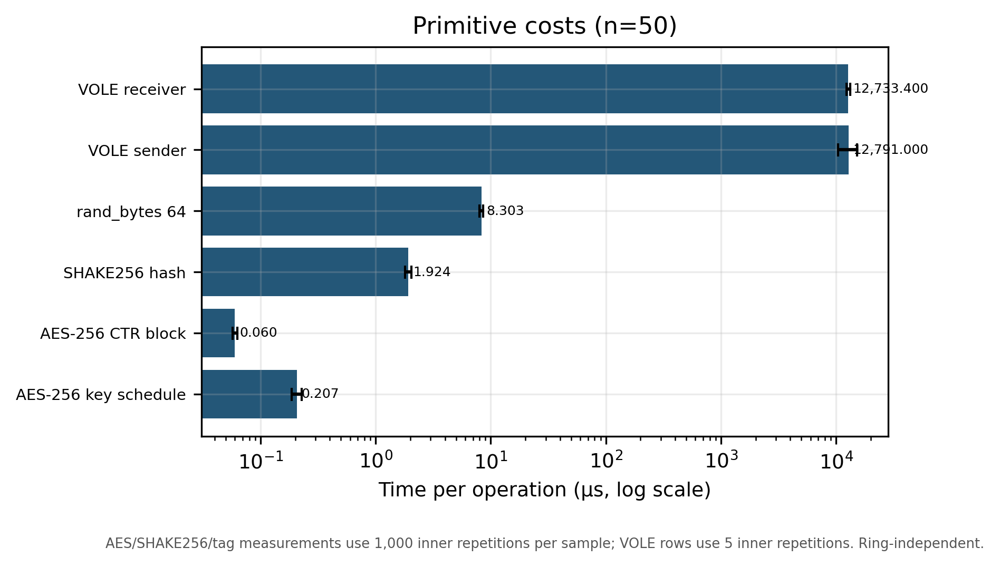
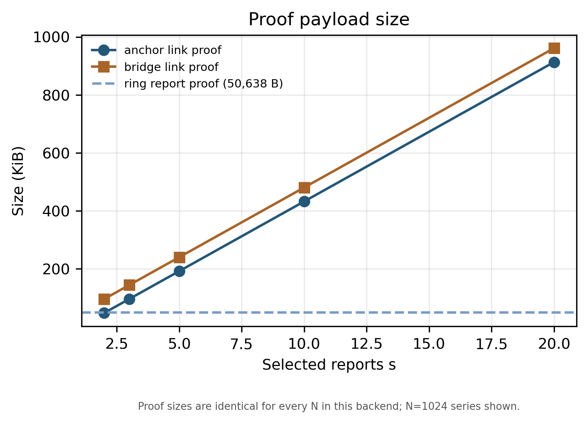
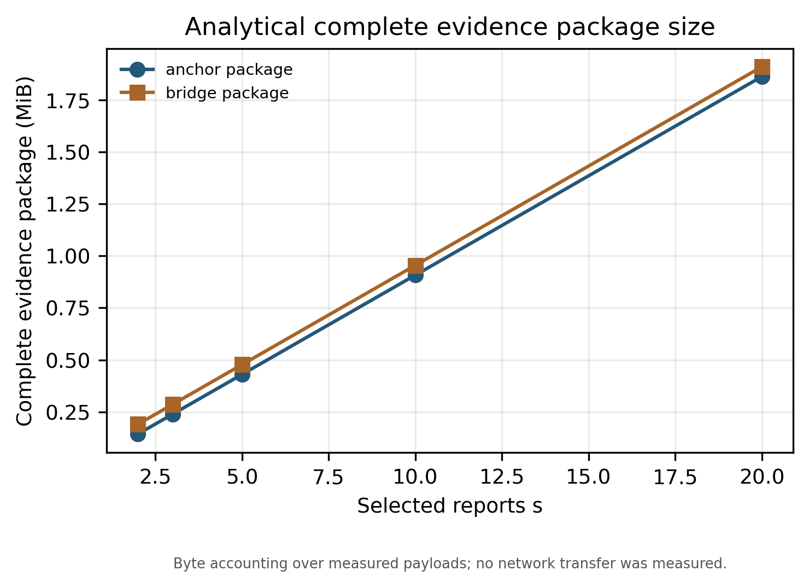
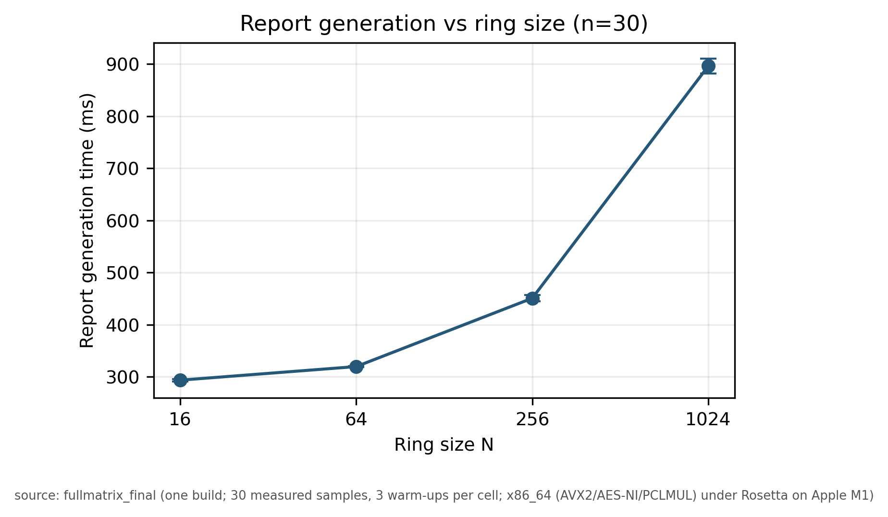
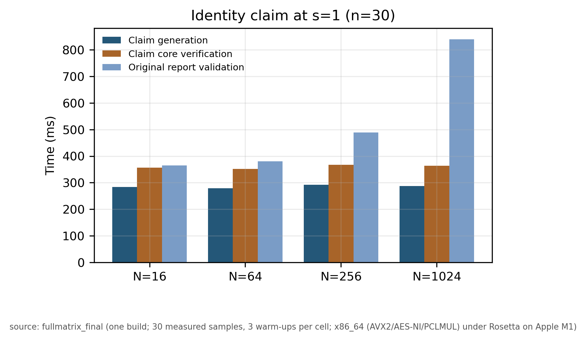
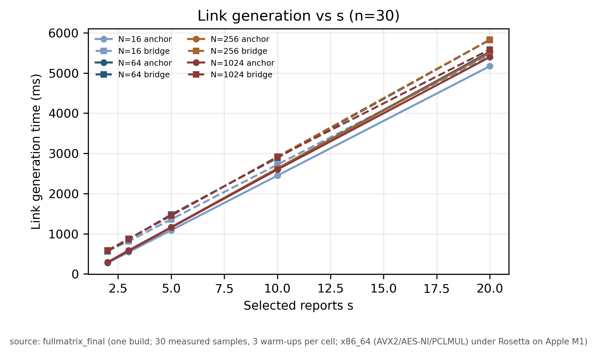
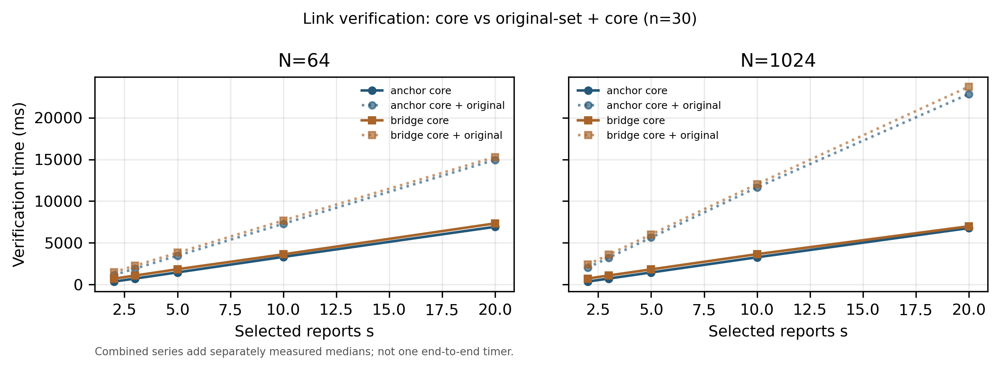
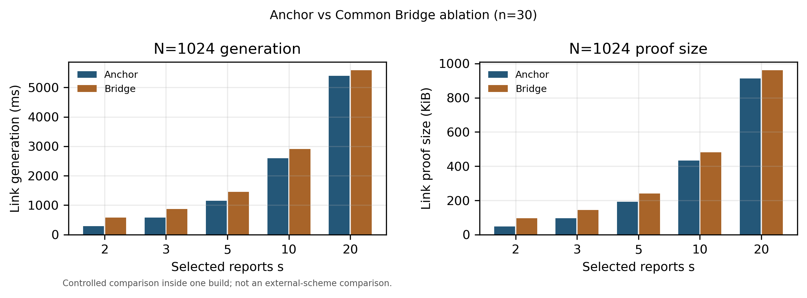
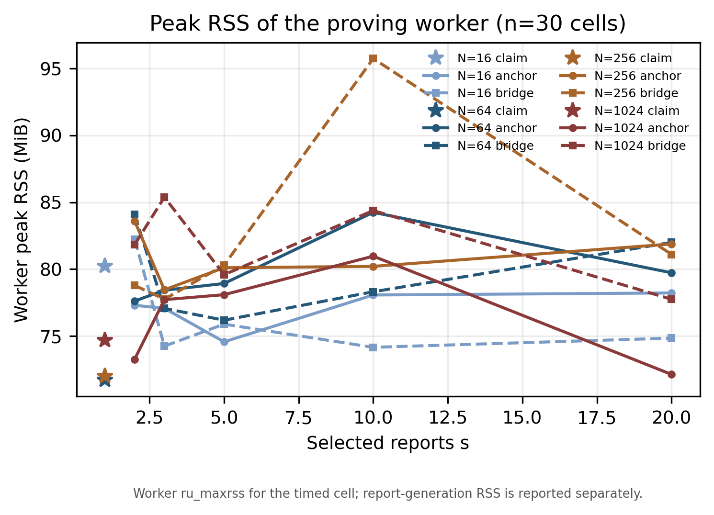

# VII. PERFORMANCE EVALUATION AND COMPARISON

This section evaluates the communication and computational overhead of CLARIS and compares its security properties with those of existing ring signature schemes. The experiments consider four ring sizes, \(N\in\{16,64,256,1024\}\), and five values for the number of selected reports, \(s\in\{2,3,5,10,20\}\). The Claim operation, which involves one report, is evaluated separately as the \(s=1\) case.

All experiments were conducted on an Apple M1 laptop with an 8-core processor and 8 GiB of memory, running macOS 15.3 (Build 24D60). The implementation was compiled using Apple Clang 16.0.0 with the -O2 optimization flag and the x86-64 target, and was executed through Rosetta 2 with AVX2, AES-NI, and PCLMUL enabled. All experiments used the CLARIS-Q-v2-G-v1 configuration. Each setting was warmed up three times and measured 30 times.

To evaluate the cost of the underlying cryptographic operations, AES-256 key expansion, AES-256 CTR block operations, SHAKE256 hashing, random-byte generation, and VOLE sender and receiver operations were measured separately. Table I reports the median, mean, standard deviation, and 95th percentile of each operation. Each primitive was measured 50 times. For AES, SHAKE256, and random-byte generation, each measurement averaged 1,000 inner repetitions; for VOLE operations, each measurement averaged five repetitions.

**TABLE I. EXECUTION TIME OF CRYPTOGRAPHIC PRIMITIVE OPERATIONS**

| Primitive Operation | Median (μs) | Mean (μs) | Std. Dev. (μs) | P95 (μs) |
|---|---:|---:|---:|---:|
| AES-256 key expansion | 0.2070 | 0.2137 | 0.0208 | 0.2358 |
| AES-256 CTR block | 0.0600 | 0.0597 | 0.0027 | 0.0610 |
| SHAKE256 hash | 1.9245 | 1.9813 | 0.1162 | 2.2293 |
| Generation of 64 random bytes | 8.3030 | 8.4053 | 0.3249 | 9.2304 |
| VOLE sender | 12,791.0000 | 13,314.5880 | 2,385.8586 | 14,967.5300 |
| VOLE receiver | 12,733.4000 | 12,816.1160 | 469.8041 | 13,830.0200 |

As shown in Table I, VOLE sender and receiver operations require more time than the other primitive operations. The operation-count analysis further shows that one ordinary proof invokes the VOLE sender 22 times during generation and the VOLE receiver 22 times during verification. These measurements are used below to analyze the computational cost of the proof procedures.

## A. Communication Overhead Comparison

The communication overhead of CLARIS consists of the public key, anonymous report, Claim proof, and Link certificate. The following analysis compares the sizes of these objects under different ring sizes and numbers of selected reports.

### 1) Anonymous Report Size

The public key of each ring member occupies 64 B. In the evaluated profile, no separate serialized public-parameter file is required. Table II presents the sizes of the anonymous report proof, the complete report payload, and the ring registry.

**TABLE II. COMMUNICATION OVERHEAD OF ANONYMOUS REPORTS**

| Ring Size \(N\) | Report Proof (B) | Report Payload (B) | Ring Registry (B) |
|---:|---:|---:|---:|
| 16 | 50,638 | 50,830 | 2,048 |
| 64 | 50,660 | 50,852 | 8,192 |
| 256 | 50,704 | 50,896 | 32,768 |
| 1024 | 50,792 | 50,984 | 131,072 |

The report payload consists of the report proof and 192 B of message, nonce, and tag fields. As \(N\) increases from 16 to 1024, the report proof grows by only 154 B, whereas the registry increases from 2,048 B to 131,072 B. Thus, the report proof size remains nearly unchanged over the evaluated ring sizes, while the registry size grows linearly with \(N\).

### 2) Claim and Link Proof Sizes

The Claim proof and each Link edge proof use the same ordinary proof relation. The measured size of one proof is

\[
p_G=49,208\ \mathrm{B}.
\]

The complete Claim certificate additionally contains the claimant index, report identifier, and context, giving a total size of 49,276 B.

For a set of \(s\) selected reports, Anchor uses one report as the anchor and generates proofs for the remaining \(s-1\) reports. Common Bridge generates one proof for each of the \(s\) reports and includes a 64 B public Bridge tuple. Therefore, their proof sizes are

\[
C_{\mathrm{Anchor}}(s)=(s-1)p_G,
\]

\[
C_{\mathrm{Bridge}}(s)=sp_G+64.
\]

Table III compares the proof sizes of the two structures.

**TABLE III. LINK PROOF SIZES UNDER DIFFERENT NUMBERS OF SELECTED REPORTS**

| \(s\) | Anchor Proofs | Anchor Size (B) | Bridge Proofs | Bridge Size Including Tuple (B) |
|---:|---:|---:|---:|---:|
| 2 | 1 | 49,208 | 2 | 98,480 |
| 3 | 2 | 98,416 | 3 | 147,688 |
| 5 | 4 | 196,832 | 5 | 246,104 |
| 10 | 9 | 442,872 | 10 | 492,144 |
| 20 | 19 | 934,952 | 20 | 984,224 |

For the same selected set, Anchor saves one ordinary proof and therefore reduces the proof size by 49,208 B. The Bridge tuple adds another 64 B to the Common Bridge certificate.

### 3) Complete Evidence Package Size

The complete evidence package contains the association certificate, the selected report payloads, and a 32 B manifest digest. Table IV gives the resulting sizes when \(N=1024\).

**TABLE IV. COMPLETE EVIDENCE PACKAGE SIZES WHEN \(N=1024\)**

| Number of Reports \(s\) | Anchor (B) | Common Bridge (B) |
|---:|---:|---:|
| 2 | 151,308 | 200,580 |
| 3 | 251,532 | 300,804 |
| 5 | 451,980 | 501,252 |
| 10 | 953,100 | 1,002,372 |
| 20 | 1,955,340 | 2,004,612 |

When \(s=20\), the Anchor evidence package occupies 1,955,340 B, whereas the Common Bridge package occupies 2,004,612 B. The difference is 49,272 B, consisting of one ordinary proof (49,208 B) and the 64 B Bridge tuple. The same difference is maintained for all evaluated values of \(s\).

Fig. 2 shows the proof size as the number of selected reports increases, and Fig. 3 presents the corresponding complete evidence package sizes.

## B. Computational Overhead Comparison

The computational overhead is evaluated in terms of anonymous report generation and verification, Claim proof generation and verification, and Link proof generation and verification. The execution times are reported as medians of 30 measurements.

### 1) Anonymous Report Generation and Verification

Table V presents the generation and verification times of anonymous reports under different ring sizes.

**TABLE V. GENERATION AND VERIFICATION TIMES OF ANONYMOUS REPORTS**

| Ring Size \(N\) | Generation (ms) | Generation Std. Dev. (ms) | Verification (ms) | Verification Std. Dev. (ms) |
|---:|---:|---:|---:|---:|
| 16 | 293.80 | 6.34 | 358.02 | 4.64 |
| 64 | 319.87 | 1.58 | 380.40 | 9.20 |
| 256 | 450.91 | 11.70 | 486.79 | 33.72 |
| 1024 | 896.12 | 19.92 | 834.28 | 23.64 |

As the ring size increases from 16 to 1024, the report generation time increases from 293.80 ms to 896.12 ms, and the verification time increases from 358.02 ms to 834.28 ms. Fig. 4 and Fig. 5 illustrate the changes in generation and verification time, respectively.

### 2) Claim Generation and Verification

The Claim operation generates one ordinary proof. Table VI presents the Claim generation time, core proof verification time, and the time required to verify the original report.

**TABLE VI. COMPUTATIONAL OVERHEAD OF THE CLAIM OPERATION**

| Ring Size \(N\) | Claim Generation (ms) | Claim Core Verification (ms) | Original Report Verification (ms) |
|---:|---:|---:|---:|
| 16 | 283.51 | 356.98 | 364.75 |
| 64 | 278.57 | 351.58 | 380.07 |
| 256 | 292.40 | 366.91 | 489.50 |
| 1024 | 286.72 | 363.63 | 839.91 |

The Claim generation time ranges from 278.57 ms to 292.40 ms, while the core verification time ranges from 351.58 ms to 366.91 ms. Both remain nearly constant as the ring size increases. This is because the Claim relation checks the correspondence between the report tag and the designated public key, without repeating the ring-member selection relation.

The verifier also checks the original report referenced by the Claim. Therefore, the original report verification time is listed separately from the Claim core verification time. Fig. 6 presents the Claim generation and core verification times.

### 3) Link Generation and Verification

Table VII compares the generation and core verification times of Anchor and Common Bridge for \(N=64\) and \(N=1024\). The original report-set verification time is not included in these measurements.

**TABLE VII. COMPUTATIONAL OVERHEAD OF ANCHOR AND COMMON BRIDGE**

| \(N\) | \(s\) | Anchor Generation (ms) | Anchor Verification (ms) | Bridge Generation (ms) | Bridge Verification (ms) |
|---:|---:|---:|---:|---:|---:|
| 64 | 2 | 284.04 | 361.13 | 562.54 | 711.16 |
| 64 | 3 | 574.17 | 725.62 | 863.09 | 1,085.52 |
| 64 | 5 | 1,161.76 | 1,464.66 | 1,476.34 | 1,840.67 |
| 64 | 10 | 2,625.40 | 3,320.30 | 2,889.12 | 3,628.19 |
| 64 | 20 | 5,529.39 | 6,928.16 | 5,826.55 | 7,334.73 |
| 1024 | 2 | 287.11 | 362.42 | 578.98 | 725.83 |
| 1024 | 3 | 578.80 | 728.15 | 871.05 | 1,095.57 |
| 1024 | 5 | 1,155.68 | 1,457.26 | 1,454.64 | 1,824.85 |
| 1024 | 10 | 2,597.68 | 3,275.17 | 2,906.29 | 3,649.11 |
| 1024 | 20 | 5,397.44 | 6,772.29 | 5,584.99 | 6,991.57 |

The generation and verification times of both structures increase with \(s\), since more ordinary proofs are required as more reports are selected. Anchor generates \(s-1\) proofs, whereas Common Bridge generates \(s\) proofs.

For example, when \(N=1024\) and \(s=2\), Anchor reduces the generation time from 578.98 ms to 287.11 ms and the verification time from 725.83 ms to 362.42 ms. The corresponding reductions are 50.4% and 50.1%, respectively. When \(s=20\), the reductions are 3.4% and 3.1%, respectively, because the saving of one proof accounts for a smaller proportion of the total computation.

The measured results follow the proof-count relationship of the two constructions. Their approximate computational costs can be expressed as

\[
T_{\mathrm{Anchor}}(s)\approx(s-1)T_G,
\]

\[
T_{\mathrm{Bridge}}(s)\approx sT_G,
\]

where \(T_G\) denotes the generation or verification time of one ordinary proof. Figs. 7 and 8 show the generation and verification times under different values of \(s\). Fig. 9 compares the two linking structures directly.

### 4) Cost Calculation from Primitive Operations

To further analyze the computational cost, the invocation counts of AES, SHAKE256, and VOLE operations were collected using a separate instrumented build. Table VIII lists the main operation counts for generating and verifying one ordinary proof when \(N=64\).

**TABLE VIII. PRIMITIVE OPERATION COUNTS FOR ONE ORDINARY PROOF WHEN \(N=64\)**

| Operation | Generation | Verification |
|---|---:|---:|
| AES-256 key expansion | 122,880 | 122,604 |
| AES-256 block calls | 7,065,598 | 7,062,606 |
| SHAKE256 init | 8 | 61,426 |
| SHAKE256 update | 303 | 307,393 |
| SHAKE256 final | 8 | 61,426 |
| SHAKE256 x4 init | 15,367 | 5 |
| SHAKE256 x4 update | 76,842 | 20 |
| SHAKE256 x4 final | 15,380 | 5 |
| VOLE sender | 22 | 0 |
| VOLE receiver | 0 | 22 |

According to Table VIII, one proof generation invokes the VOLE sender 22 times, and one proof verification invokes the VOLE receiver 22 times. Using the median execution times in Table I, the VOLE component can be calculated as follows:

\[
\begin{aligned}
T_{\mathrm{VOLE,Gen}}
&=22T_{\mathrm{sender}}\\
&=22\times12.791\\
&=\boxed{281.402\ \mathrm{ms}}.
\end{aligned}
\]

Similarly, the VOLE component of proof verification is

\[
\begin{aligned}
T_{\mathrm{VOLE,Ver}}
&=22T_{\mathrm{receiver}}\\
&=22\times12.7334\\
&=\boxed{280.1348\ \mathrm{ms}}.
\end{aligned}
\]

These values represent the VOLE component of one proof. The remaining computation comes from AES, SHAKE256, transcript processing, witness expansion, and other protocol operations. This operation-level analysis is consistent with the measured generation and verification times in Tables VI and VII.

### 5) Memory Overhead

The peak resident set size (RSS) was recorded during report generation, proof generation, and independent public verification. The proof-generation worker used 71.7–95.7 MiB of peak memory, while the report-generation driver used 71.8–87.5 MiB. Fig. 10 presents the peak memory consumption under different numbers of selected reports.

The functional tests were also conducted for all four ring sizes. The test suite passed 53 joint checks, 23 public-verification checks, and 22 identity-free linking checks, covering valid and invalid claims, same-owner and different-owner report sets, and tampering with report contents, identifiers, and contexts.

### 6) Reference Implementation

For reference, Table IX lists the signature sizes, generation times, and verification times of the public VOLE-in-the-Head threshold ring signature implementation by Chiang et al. The implementation was tested under 128-bit and 256-bit configurations.

**TABLE IX. REFERENCE PERFORMANCE OF CHIANG ET AL.'S PUBLIC IMPLEMENTATION**

| Ring Size \(N\) | 128-bit Signature (B) | Generation (ms) | Verification (ms) | 256-bit Signature (B) | Generation (ms) | Verification (ms) |
|---:|---:|---:|---:|---:|---:|---:|
| 16 | 4,594 | 4.709 | 9.408 | 20,184 | 11,524.973 | 61.005 |
| 64 | 4,594 | 4.714 | 9.284 | 20,184 | 16,153.538 | 71.249 |
| 256 | 4,594 | 5.205 | 9.510 | 20,184 | 11,298.808 | 61.677 |
| 1024 | 4,594 | 5.048 | 9.224 | 20,184 | 10,603.060 | 61.750 |

The reference implementation was compiled with GCC 13 and executed on AMD EPYC processors under Ubuntu 24.04. CLARIS was evaluated on Apple M1 through Rosetta 2. The results in Table IX provide implementation-level reference data for VOLE-in-the-Head ring signatures. The two implementations also support different security configurations and functionalities.

## C. Security and Property Comparison

The security and functionality of CLARIS are compared with existing claimable ring signatures, user-controlled linkable ring signatures, post-quantum VOLE-in-the-Head ring signatures, symmetric-primitive-based linkable ring signatures, and accountable ring signatures. Table X summarizes their main constructions and supported properties.

**TABLE X. SECURITY AND FUNCTIONALITY COMPARISON**

| Scheme | Main Construction | Post-Quantum Security Basis | Anonymous Ring Signature | Post-hoc Identity Claiming | Selective or User-Controlled Linking | Accountability or Opening |
|---|---|---|:---:|---|---|---|
| Park–Sealfon [1] | Claimable ring signature | No post-quantum construction claim | ✓ | Claimability and repudiability | Not the main functionality | Claimability/repudiability |
| Fiore et al. [2] | RS-UCL / RS-UCAL | Depends on the underlying ring signature | ✓ | Not the main functionality | ✓ | No centralized opener required by RS-UCL |
| Chiang et al. [3] | AES/VOLEitH threshold ring signature | Symmetric-primitive-based post-quantum construction | ✓ | No CLARIS-style named-key Claim interface | Key-binding tags provide linkability | Threshold aggregation |
| DualRing-PRF [4] | Legendre and power-residue PRFs | Symmetric-primitive-based post-quantum construction | ✓ | Not the main functionality | ✓ | Non-slanderability is discussed |
| SPRING [5] | Module-lattice ring signature | Lattice-based post-quantum construction | ✓ | Not the demonstrated functionality | Relation proofs considered as an extension | Designated-opener accountability |
| **CLARIS** | **AES-256, SHAKE256, and VOLE-in-the-Head** | **Non-lattice-based post-quantum approach based on symmetric cryptographic primitives; conditional on the joint-proof and tuple assumptions** | **✓** | **✓, signer-authorized public identity claiming** | **✓, signer-authorized selective report linking** | **No designated opener** |

Park–Sealfon [1] studies claimability and repudiability in ring signatures. Fiore et al. [2] introduce user-controlled linkable ring signatures and formalize the RS-UCL and RS-UCAL functionalities. Chiang et al. [3] construct threshold ring signatures based on AES and VOLE-in-the-Head. DualRing-PRF [4] provides linkable ring signatures based on symmetric pseudorandom functions, while SPRING [5] adopts a module-lattice construction and supports designated-opener accountability.

CLARIS combines anonymous reporting with two signer-authorized disclosure operations. Claim allows the signer to reveal the registered identity associated with an individual report. Link allows the signer to prove that a selected set of reports belongs to the same registered user without directly revealing that user's identity. These two operations provide distinct disclosure functionalities within the same reporting framework.

In terms of its cryptographic construction, CLARIS follows a non-lattice-based post-quantum approach based on symmetric cryptographic primitives. Its security analysis relies on the joint zero-knowledge proof system and the corresponding AES-tuple assumptions. The post-quantum security guarantee is therefore established under the assumptions and proof-system conditions stated in the security analysis.

## REFERENCES

[1] Park and Sealfon, “It Wasn't Me! Repudiability and (Un)claimability of Ring Signatures,” CRYPTO 2019. https://www.iacr.org/archive/crypto2019/116940474/116940474.pdf

[2] Fiore et al., “Ring Signatures with User-Controlled Linkability,” ESORICS 2022. https://eprint.iacr.org/2022/1743

[3] Chiang et al., “Post-Quantum Threshold Ring Signature Applications from VOLE-in-the-Head,” CCS 2025. https://eprint.iacr.org/2025/113

[4] Zhang et al., “DualRing-PRF: Post-Quantum (Linkable) Ring Signatures from Legendre and Power Residue PRFs,” ACISP 2024. https://eprint.iacr.org/2024/985

[5] Zhang, Luo, and Huang, “SPRING: Sign-then-prove ring signatures from lattices with compactness, extensibility, and efficiency,” Computer Standards & Interfaces, 96 (2026). https://doi.org/10.1016/j.csi.2025.104084